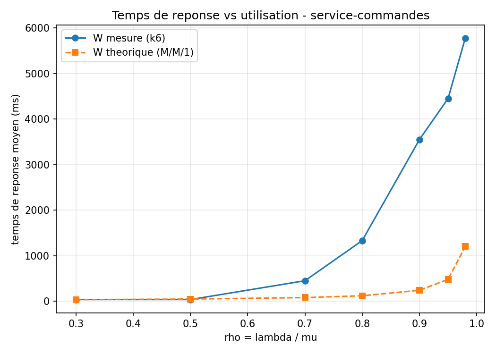

# TP2 — Modélisation M/M/1 et rigueur du benchmarking

::: meta
**Cours :** Performance et Optimisation des Systèmes — L3 DAR, Semaine 2\
**Auteur :** El Hadji Fallou Bousso\
**Université :** Université Cheikh Akhmadoul Khadim\
**Dépôt Git :** [github.com/serignefalloubousso99-dot/tp-perf-l3](https://github.com/serignefalloubousso99-dot/tp-perf-l3)
:::

## Environnement de mesure

Même service que le TP1 (`service-commandes`, Node.js, port 8080), testé
sous WSL2 (Ubuntu 24.04). J'ai fixé `iterations=16000000`, ce qui donne un
temps de service d'environ 24 ms par requête (dans la fourchette
demandée). Générateur de charge : **k6** (modèle ouvert, débit constant)
et **ab** (modèle fermé).

---

## Partie A — Trouver µ (débit maximum)

### Exercice 1.1

En augmentant la concurrence avec `ab` (5, 10, 20, 40, 80, 120), le débit
plafonne autour de **µ ≈ 40 req/s** (entre `c=5` et `c=20`). Au-delà de
`c=40`, le débit ne stagne pas : il **baisse** (jusqu'à ~28 req/s), avec
beaucoup de requêtes en échec. Trop de concurrence surcharge le service.

---

## Partie B — Courbe temps de réponse / utilisation

### Exercice 2.1 — Balayage avec k6 (modèle ouvert)

| ρ visé | Débit visé | Débit réel | Temps de réponse moyen |
|---|---|---|---|
| 30 % | 12 | 12 | 38 ms |
| 50 % | 20 | 20 | 37 ms |
| 70 % | 28 | 27 | 450 ms |
| 80 % | 32 | 28 | 1 332 ms |
| 90 % | 36 | 27 | 3 550 ms |
| 95 % | 38 | 25 | 4 452 ms |
| 98 % | 39 | 25 | 5 777 ms |

On voit qu'à partir de ρ = 70 %, le débit réel n'augmente plus vraiment
(il reste autour de 25-28 req/s) alors que le temps de réponse explose.

### Exercice 2.2 — Comparaison à la théorie M/M/1

Formule : `W = (1/µ) / (1 - ρ)`, avec 1/µ ≈ 24 ms.

| ρ | W théorique | W mesuré |
|---|---|---|
| 30 % | 34 ms | 38 ms |
| 50 % | 48 ms | 37 ms |
| 70 % | 80 ms | 450 ms |
| 80 % | 120 ms | 1 332 ms |
| 90 % | 240 ms | 3 550 ms |
| 95 % | 480 ms | 4 452 ms |
| 98 % | 1 200 ms | 5 777 ms |

**Les deux courbes se ressemblent-elles ?** À faible charge (30-50 %),
oui. Mais à partir de 70 %, l'écart devient énorme. La raison est simple :
le débit maximum réel du service (mesuré sur une charge soutenue) est en
fait plus proche de **27-28 req/s** que de 40. Le test de l'exercice 1.1
était trop court pour le voir : il donnait un débit un peu trop optimiste.
Donc dès que la charge visée dépasse ~28 req/s, le service est en réalité
déjà saturé, même si le calcul affiche "70 %".

**À partir de quel ρ faut-il ajouter des serveurs ?** Je propose **50-60 %**
: c'est le dernier point où le temps de réponse reste stable dans nos
mesures. Attendre 70 % ou plus, comme le montre le tableau, est déjà trop
tard.

---

## Partie C — Modèle ouvert vs modèle fermé

### Exercice 3.1

Même niveaux de charge (ρ = 90 % et 98 %), mesurés cette fois avec `ab`
(modèle fermé) :

| ρ | Modèle fermé (ab) | Modèle ouvert (k6) |
|---|---|---|
| 90 % | 1 292 ms | 3 550 ms |
| 98 % | 1 382 ms | 5 777 ms |

**Lequel sous-estime la dégradation réelle ?** Le **modèle fermé**. Avec
`ab`, chaque client attend sa réponse avant d'envoyer la suivante : le
nombre de requêtes en attente reste donc limité au nombre de clients. Un
vrai trafic (modèle ouvert) continue d'arriver même si le service est
lent, et la file d'attente peut grossir sans limite. Le modèle fermé donne
donc une image trop rassurante de la réalité.

**Quand le modèle fermé reste-t-il valable ?** Quand le nombre de clients
est vraiment limité et fixe, par exemple un nombre fixe de caisses dans un
magasin, ou un pool de connexions internes.

---

## Partie D — Audit d'un protocole de benchmark

Protocole du camarade : *"Une seule fois `ab -n 50 -c 50`, pendant que je
regarde une vidéo et que mon IDE compile. J'ai eu 850 req/s. Le service
tient donc 850 req/s en continu."*

| Erreur | Principe violé | Correction |
|---|---|---|
| Vidéo + compilation en même temps que le test | Environnement isolé | Fermer les autres applications, ou tester sur une machine séparée |
| Mesure prise dès la première seconde | Warm-up | Laisser le service se stabiliser avant de mesurer |
| Un seul essai | Répétitions | Répéter le test plusieurs fois |
| Conclusion ("en continu") différente de ce qui est testé (un instant) | Hypothèse claire | Mesurer sur une durée longue avant de parler de débit soutenu |
| Aucun détail noté (version, config, date) | Consignation | Toujours noter la configuration exacte du test |

---

## Conclusion

La leçon principale de ce TP : le débit maximum "mesuré rapidement" (40
req/s) n'était pas le vrai débit soutenable (27-28 req/s). Il faut tester
sur une durée longue pour avoir un chiffre fiable. Le modèle fermé (comme
`ab`) est pratique mais peut cacher une vraie dégradation si le trafic réel
est ouvert.
