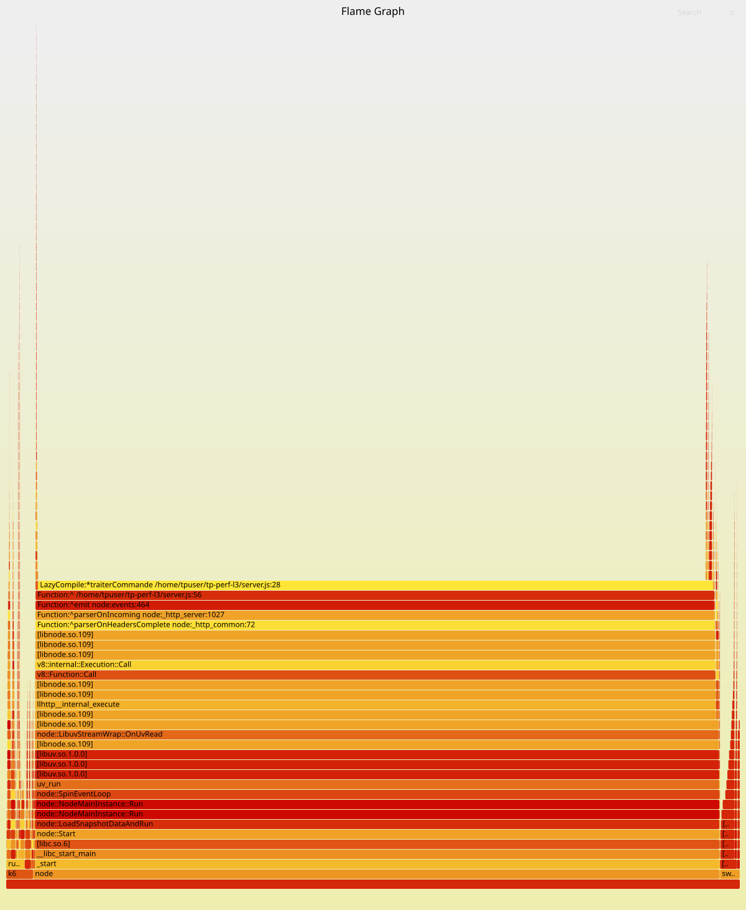

# TP3 — Profilage système et méthode USE

::: meta
**Cours :** Performance et Optimisation des Systèmes — L3 DAR, Semaine 3\
**Auteur :** El Hadji Fallou Bousso\
**Université :** Université Cheikh Akhmadoul Khadim\
**Dépôt Git :** [github.com/serignefalloubousso99-dot/tp-perf-l3](https://github.com/serignefalloubousso99-dot/tp-perf-l3)
:::

## Environnement de mesure

Même service (`service-commandes`, Node.js, port 8080), testé sous WSL2
(Ubuntu 24.04). Deux charges différentes, obtenues juste en changeant le
paramètre `iterations` :

- **Variante CPU-bound** : `iterations=16000000` (beaucoup de calcul),
  charge à 22 req/s.
- **Variante I/O-bound** : `iterations=1` (calcul quasi nul, seul le
  `fsync` du log compte), charge à 176 req/s.

*Note :* `perf` n'a pas pu s'attacher directement au processus (souci
connu avec le noyau de WSL2). J'ai donc utilisé son mode d'analyse globale
du système à la place, ce qui donne le même résultat ici puisque le
service est le seul programme actif pendant le test.

---

## Partie A — Vue système globale

### Exercice 1.1 — Variante CPU-bound

`vmstat` : CPU utilisateur (`us`) à ~12 %, attente disque (`wa`) à ~1 %.

`mpstat -P ALL` : **un seul cœur** est chargé à ~93 %, les 7 autres sont
presque à 0 %.

**Hypothèse :** le CPU est la ressource limitante, et le service n'utilise
qu'un seul cœur (il est mono-thread).

### Exercice 1.2 — Variante I/O-bound

`vmstat` : `wa` monte à ~3 % (contre 1 % avant), `us` descend à ~1-2 %.

`iostat -x` : le disque du fichier de log passe de 2-8 % à **18-27 %**
d'utilisation, avec 352 `fsync` par seconde. Le temps de chaque `fsync`
reste court (~0.4 ms), mais leur nombre pèse sur le débit.

**Pourquoi le `fsync` limite le débit sans saturer le CPU ?** Parce que
c'est un appel bloquant : le service attend la fin du `fsync` avant de
traiter la requête suivante, même si le CPU ne fait rien pendant ce
temps.

---

## Partie B — `perf` et `strace`

### Exercice 2.1 — Profil CPU (variante CPU-bound)

`perf report` montre que **92 % du temps CPU** est passé dans une seule
fonction : `traiterCommande` (server.js, ligne 28). Aucune autre fonction
ne dépasse 0.05 %.

C'est exactement la fonction attendue (la boucle de calcul + l'écriture du
log), pas un coût caché ailleurs. Il n'y a donc qu'une seule chose à
optimiser si besoin : cette fonction.

### Exercice 2.2 — `strace` (variante I/O-bound)

```
write(127, "...", 29) = 29 <0.000060>
fsync(127)            = 0  <0.001461>
```

Chaque `fsync` prend entre 1.3 et 2 ms sous `strace` (un peu plus qu'en
temps normal, car `strace` ralentit lui-même le programme observé — c'est
un piège classique, à ne jamais oublier).

Sur un temps de requête total d'environ 5 ms (variante I/O-bound), le
`fsync` représente donc une bonne partie du coût.

**Piste d'optimisation :** regrouper plusieurs écritures avant de faire un
seul `fsync`, au lieu d'un `fsync` à chaque requête. Le compromis : si le
service plante entre deux regroupements, les dernières commandes non
encore écrites sur disque seraient perdues.

---

## Partie C — Grille USE (variante I/O-bound)

| Ressource | Utilisation | Saturation | Erreurs |
|---|---|---|---|
| CPU | ~1-2 % par cœur | file d'attente CPU quasi nulle | aucune |
| Mémoire | 516 Mo / 7.8 Go utilisés | pas de swap utilisé | aucune |
| Disque | 18-27 % d'utilisation | file d'attente disque modérée | aucune |
| Réseau | ~200 connexions locales | rien d'anormal | aucune |

**Ressource la plus préoccupante :** le **disque** (à cause du `fsync`).
Le CPU, la mémoire et le réseau sont largement dans leurs limites.

Ce résultat va dans le même sens que `perf` et `strace` : deux méthodes
différentes pointent vers la même conclusion.

---

## Partie D — Flame graph



Le plateau le plus large et le plus haut du graphe correspond à
`traiterCommande`, la même fonction déjà repérée avec `perf`.

L'axe horizontal du flame graph **n'est pas une chronologie** : il montre
seulement à quelle fréquence chaque fonction a été vue active pendant la
mesure, classées par ordre alphabétique.

---

## Partie E — Diagnostic final

**1. Symptôme.** Le temps de réponse explose dès que la charge dépasse
~28 req/s (voir TP2).

**2. Ressource limitante.** Le **CPU** (un seul cœur, confirmé par
`mpstat` et `perf`) en variante CPU-bound ; le **disque** (`fsync`,
confirmé par `iostat` et `strace`) en variante I/O-bound. Dans les deux
cas, le service traite tout l'un après l'autre, sans parallélisme.

**3. Fonction en cause.** `traiterCommande` (server.js, ligne 28) — 92 %
du CPU, et le `fsync` bloquant qu'elle contient.

**4. Recommandation.** Passer le service en plusieurs workers (testé au
TP1 : gain de x3.2 avec 4 workers) pour utiliser plusieurs cœurs, et
regrouper les écritures du log pour réduire le nombre de `fsync`. Le
compromis : un peu moins de garantie en cas de panne pour le log, en
échange d'un débit plus élevé.
